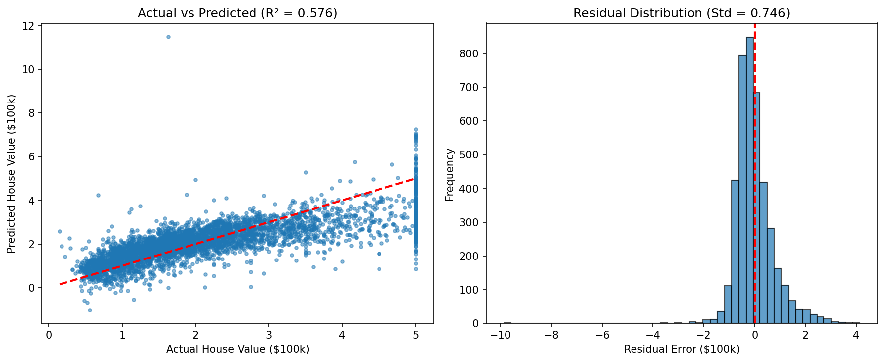

[](https://opensource.org/licenses/MIT)
[](https://www.python.org/)

# California Housing Price Prediction

An interpretable machine learning baseline that predicts median house values for California districts using the California Housing dataset and ordinary least squares Linear Regression.

## Project Highlights

- Built an end-to-end regression workflow from dataset loading through evaluation and visualization.
- Prepared the data by separating predictors from the target and creating reproducible training and test sets.
- Trained a Linear Regression model on 16,512 districts and evaluated it on 4,128 unseen districts.
- Compared training and test performance to identify and quantify overfitting.
- Visualized prediction quality and residual errors to support model diagnostics.

## Dataset

The project uses the California Housing dataset, based on 1990 California census data:

- **Observations:** 20,640 districts
- **Features:** 8 numerical demographic and geographic variables
- **Target:** `MedHouseVal`, median house value in units of $100,000
- **Split:** 80% training / 20% test, with `random_state=42`

## Results

The model provides a useful, interpretable baseline:

| Metric | Training set | Test set |
|---|---:|---:|
| RMSE | $71,967.57 | $74,558.14 |
| MAE | $52,862.84 | $53,320.01 |
| R² | 0.6126 | 0.5758 |

### Overfitting check

The difference between training and test R² is **0.0368**, indicating mild overfitting while retaining reasonably consistent performance on unseen data.

### Diagnostic visualization



The figure compares actual and predicted values (left) and shows the distribution of test-set residuals (right).

## Tech Stack

- **Python** — project implementation
- **pandas** — tabular data handling
- **NumPy** — numerical calculations
- **scikit-learn** — dataset, train/test split, model, and metrics
- **matplotlib** — model diagnostics and visualization

## Run Locally

1. Clone the repository and move into the project directory.
2. Install the dependencies:

   ```bash
   pip install pandas numpy scikit-learn matplotlib
   ```

3. Run the pipeline:

   ```bash
   python -X utf8 housing_project.py
   ```

The script downloads the dataset through scikit-learn, prints evaluation metrics, and saves the diagnostic figure as `model_results.png`.

## Project Structure

```text
.
├── housing_project.py   # Data loading, training, evaluation, and plots
├── model_results.png    # Generated model diagnostic visualization
├── README.md            # Project documentation
└── LICENSE              # MIT license
```

## Resume Summary

**California Housing Price Prediction — Python, pandas, NumPy, scikit-learn, matplotlib**

Built an end-to-end Linear Regression pipeline to predict median California house values; prepared and split 20,640 records, evaluated model performance with RMSE, MAE, and R², and diagnosed mild overfitting by comparing training and test results.

## Limitations and Next Steps

This project is intentionally designed as an interpretable baseline. Potential improvements include feature scaling and transformation, stronger nonlinear models, cross-validation, hyperparameter tuning, and additional error analysis by location and income level.
